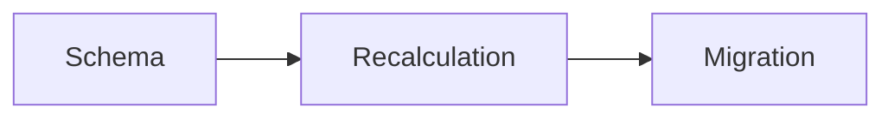

# What content renders as

Content fields are markdown and are shown rendered: a task's brief (`context`, `constraints`,
`criteria`) and its work (`plan`, `progress`, `result`), the `body` and the `evidence` of a
stage, the `body` of a journal entry, of a task note and of a codex note. The goal
(`description`) renders too, as plain paragraphs.

Ordinary markdown works — headings, lists, tables, links, inline code, fenced code with
highlighting. Three things are worth knowing because guessing them wrong is silent.

## Headings are also edit handles

`content_set_section(code, field, heading, text)` replaces one section, from its heading down to
the next heading of equal or higher level. That makes headings the unit you can rewrite later
without resending the whole field.

Two consequences for how you write:

- **Give a section a heading you can name.** A unique one: a heading that repeats is refused,
  and you then have to address it by path (`## Plan > ### Risks`).
- A `#` line inside a fenced block is code, not a heading, and never ends a section — a plan
  with a shell example in it stays intact.

## Diagrams

A fence tagged `mermaid` renders as a real diagram. Anything the renderer does not recognise
degrades to a plain code block, silently — you will not be told.

````

````

Recognised types: `flowchart` (and `graph`), `sequenceDiagram`, `classDiagram`, `stateDiagram`
(and `stateDiagram-v2`), `erDiagram`, `xychart-beta`.

Reach for one where the point *is* a structure — a pipeline, a state machine, a data schema, a
call flow. A diagram of three boxes that a sentence already said is worse than the sentence.

## Files

A file goes into a text by its code. `attach_file` answers with `insert` — the form to write.

- `FILE@<code>` — a link pill; a click opens the file in a new tab. It sits inside a sentence.
- `IMAGE@<code>` — the picture itself, given for an image. It always takes its own line: text
  before it stays above, text after it moves below — so write it on a line of its own.
- Several `IMAGE@` in one paragraph — apart by spaces or single line breaks — are one gallery:
  a row laid out by their number, each picture keeping its proportions; a click opens it full
  screen with paging. A blank line ends a gallery: two paragraphs, two galleries.
- `IMAGE@` on a file that is not a picture shows as a `FILE@` pill.
- A code whose file is gone — taken out of every place, or gone with a deleted stage — shows
  red: a pill, or a placeholder where the picture was. Writing the code is never refused;
  `file_get` says whether the file is there.

Writing a code attaches nothing — `attach_file` does. A file the task holds serves every text
of the task, its notes and stages included, so a code already in the task is written again,
never attached again.

Show what the person has to look at: a screenshot of the result or an exported chart goes in as
`IMAGE@` next to the text it supports; a document to download goes in as `FILE@`.

## Length

What happens over a limit depends on the **tool**, not only on the field:

- `content_set` and its neighbours **refuse** on every content field, and the refusal names the
  length of the result and how much over you are;
- `plan`, `progress` and `result` are refused whichever way they are written, and so are the
  body passed to `stage_add` and every field of a task note — `task_note_add` and
  `task_note_update` refuse too;
- everything else — including `context`, `constraints` and `criteria` passed to `task_create` /
  `task_update`, and the body passed to `journal_add` — is **cut without a word** (second table).

Refusing matters for plans specifically: the list of code files read and changed sits at the end,
so trimming would remove the part worth keeping.

| Content field | Limit |
|---|---|
| `context` | 4048 |
| `constraints`, `criteria` | 2048 |
| `plan` | 8192 |
| `progress` | 16384 |
| `result` | 2048 |
| stage `body` | 8192 |
| journal entry `body` | 2048 |
| task note `body` | 65536 |

If a plan is pressing the limit, the detail belongs in stages (an extended task), a subtask, or a
task note when it is material rather than steps.

Cut without a word — stay under these, and read the task back when a field was long:

| Field, and the tool that writes it | Limit |
|---|---|
| title (task, stage, entry, group) | 128 |
| goal `description`, stage `description` | 512 |
| group `description` — refused over it, not cut | 128 |
| `context` via `task_create` / `task_update` | 4048 |
| `constraints`, `criteria` via `task_create` / `task_update` | 2048 |
| entry body via `journal_add` | 2048 |
| `evidence`, `resolution` | 1024 |
